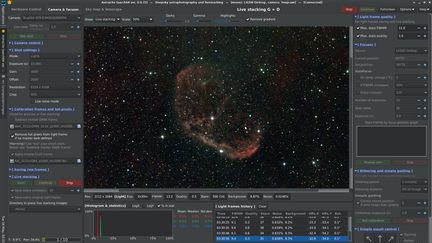
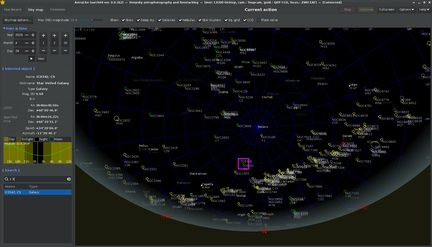

# AstraLite
AstraLite is software for deepsky astrophotography and live stacking
on low power PCs (like raspberry Pi or Orange Pi). It also works on ordinary PCs.

```diff
! The program is under active development !
```

AstraLite uses INDI server to work with astrophotography hardware.
On MS Windows ASCOM (COM) and ASCOM Alpaca devices are also supported.
See https://www.indilib.org/download.html to install INDI

Compiled binaries and discussion here:
https://www.indilib.org/forum/clients/13006-astralite-simple-indi-client-for-astrophotography.html

## Features
**Devices**
* Cameras, focusers, filter wheels and mounts connected to a local or a remote INDI server
* ASCOM (COM) and ASCOM Alpaca devices on MS Windows
* Separate guide camera, auxiliary INDI devices (switches) and filter wheel filter selection
* Panels for device settings, INDI device selection and the hardware log
* Observatory site coordinates, can be taken from connected devices

**Taking pictures**
* Single shot, live view from camera, saving RAW frames and live stacking
* Lights, darks, biases and flat frames, binning, crop, gain and offset
* Automatic flat exposure calculation
* RAW frames are saved to FITS as they come from the camera

**Image processing**
* Live stacking with **automatic satellites and meteor tracks removal**
* Background gradient automatic removal
* Darks, biases and defective pixels library
* Flat frames calibration
* Light frames quality filter: stars FWHM and ovality, CCD temperature
* Preview with levels, white balance, gamma, histogram and statistics, stars FWHM/HFD
* History of light frames taken during a session with their quality parameters
* Opening FITS, TIFF, JPEG and PNG files, saving preview as JPEG and linear image as TIFF

**Guiding, focusing and mount**
* Guiding and dithering by PHD2 or **main camera**
* Autofocus, with automatic refocus on temperature change, image quality drop or by schedule
* Manual mount control, polar alignment, goto from sky map with correction by plate solving
* Mount moves calibration for accurate dithering

**Sky map and plate solving**
* Sky map with star catalogue, more than 12000 deep sky objects, named stars and constellations
* Object search; horizon, camera field of view and the last plate solved image on the map
* Altitude over time plot with day, twilight, night and Moon illumination
* Plate solving with local Astrometry.net or with AstraLite's own fast solver

## Requirements
| Condition                        | Requirements for 12 MP sensors | Requirements for 24 MP sensors |
|----------------------------------|--------------------------------|--------------------------------|
| Astrophotography only            | >= 2 CPU cores, >= 1 GB of RAM | >= 2 CPU cores, >= 2 GB of RAM |
| Live stacking                    | >= 2 CPU cores, >= 1 GB of RAM | >= 4 CPU cores, >= 2 GB of RAM |
| Live stacking with tracks removal | >= 2 CPU cores, >= 2 GB of RAM | >= 4 CPU cores, >= 4 GB of RAM |

**>= 4 CPU cores, >= 4 GB of RAM** is enough for most cases

## What you need to run
INDI (https://indilib.org/) - library to access devices (camera, focuser etc).
On Ubuntu:
```
sudo apt-add-repository ppa:mutlaqja/ppa
sudo apt-get update
# INDI library and all 3rd party drivers, use one of the following:
sudo apt-get install indi-full gsc               # Ubuntu 22.04-24.04
sudo apt-get install indi-3rdparty-drivers gsc   # Ubuntu 26.04 and newer
```
On MS Windows devices are accessed with ASCOM (COM) drivers or over the network
with ASCOM Alpaca. INDI server (also a remote one) can be used on Windows too.

PHD2 (https://openphdguiding.org/) for guiding *(optional)*
```
sudo add-apt-repository ppa:pch/phd2
sudo apt update
sudo apt install phd2
```

### Plate solving data
Plate solving needs astrometry.net index files and one of two solvers:
`solve-field` of a local Astrometry.net install or `starsolver`, a small and fast solver
built together with AstraLite. Without index files plate solving does not work.

`solve-field` comes with Astrometry.net:
```
sudo apt install astrometry.net
sudo apt install astrometry-data-2mass-08-19 astrometry-data-2mass-07 astrometry-data-2mass-06
sudo apt install astrometry-data-2mass-05 astrometry-data-2mass-04
```
The `astrometry-data-2mass-*` packages download the 2MASS index files while being installed.

`starsolver` solves a typical field in well under a second and needs little memory.
To use it, place the `starsolver` binary next to the AstraLite binary and put the index
files into the `index_files` directory next to it. When there is no `index_files` directory,
the indexes of an Astrometry.net installed on the system are used.

Index files can also be downloaded from https://data.astrometry.net/4100/
(the Tycho-2 index set, about 350 MB)

## Screenshots
[](./docs/screenshot1.jpg?raw=true)
[](./docs/screenshot2.png?raw=true)

## Future plans
* INDI driver crash recovery
* Live view from camera in video mode
* Meridian flip support
* Sun and Moon on the sky map

# Building AstraLite
## Prerequisites for Linux
* Rust compiler, 1.85 or newer (the code uses edition 2024): https://www.rust-lang.org/tools/install
* Libs and tools:
```
sudo apt install gcc libgtk-3-dev build-essential
```

## Prerequisites for MS Windows
* Rust compiler (x86_64-pc-windows-**gnu**): https://www.rust-lang.org/tools/install
  Note! You have to install *-gnu (not *-msvc) toolchain:
```
rustup-init.exe --default-toolchain=stable-x86_64-pc-windows-gnu --default-host=x86_64-pc-windows-gnu
```
* MSYS: https://www.msys2.org/
* Libs and tools (type inside MSYS command line):
```
pacman -S mingw-w64-x86_64-gtk3
pacman -S mingw-w64-x86_64-pkg-config base-devel mingw-w64-x86_64-gcc
```

Don't forget to set your `PATH` environment variable to point to the `mingw64\bin` directory of MSYS

## Building for your platform
To build optimized binaries for your current platform, just type
```
cargo build --release
```
The binaries are placed in `target/release`: `astra_lite` (the app) and `starsolver`
(the plate solver the app can use, see *Plate solving data* above).

## Tests
Unit tests do not need any hardware:
```
cargo test --lib -p astra_lite
```
Integration tests in `tests/` drive the whole device stack through a local `indiserver`
with simulator drivers (Linux) or ASCOM drivers (Windows). They are slow and serialized.

## Building and creating deb-packages for arm64, armhf and x86_64 platforms
### Prerequisites
* Install podman or docker (I prefer podman):
```
sudo apt install podman
```
* Install `cross` https://github.com/cross-rs/cross :
```
cargo install cross --git https://github.com/cross-rs/cross
```
### How to build
Execute `build_cross.sh`. Once `build_cross.sh` has finished running, you will find the deb packages in the `dist` folder.

Note: the deb package contains the app and the sky map data, `starsolver` is not packaged.

## Data sources
DSO:
* Messier, NGC and IC catalogue from OpenNGC - https://github.com/mattiaverga/OpenNGC
* Caldwell catalogue - http://www.hawastsoc.org/deepsky/caldwell.html
* DSO nicknames list - https://www.astrobin.com/fg7b5l/

Stars:
* Tycho-2 catalogue - https://www.cosmos.esa.int/web/hipparcos/tycho-2
* HYG v3 catalogue - https://github.com/astronexus/HYG-Database/tree/main/hyg/v3
  (this GitHub repository is archived; the catalogue moved to https://codeberg.org/astronexus/hyg,
  where the current version is HYG v4.4)

Constellations:
* Celestial Data - https://github.com/dieghernan/celestial_data

## License
MIT - see [LICENSE](./LICENSE)
