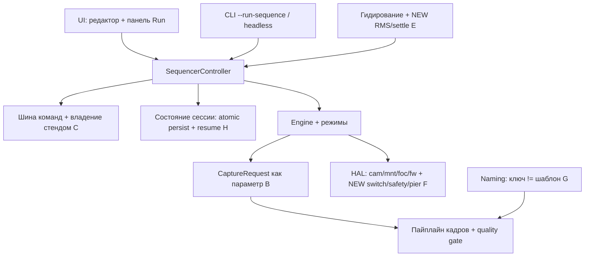

# Секвенсор: что доработать в архитектуре AstraLite

Документ отвечает на вопрос **не «как написать секвенсор»**, а «что мешает
реализовать секвенсор сейчас и какие изменения текущей архитектуры сделают его
появление дешёвым и неболезненным». Функциональная спецификация самого
секвенсора — в `docs/sequencer.md`.

Принцип отбора изменений: сначала те, что **полезны сами по себе** и не меняют
поведение приложения (рефакторинг, выделение интерфейсов, развязывание
зависимостей), затем — минимальные точки расширения, которые секвенсор будет
использовать. Сам конечный автомат секвенсора здесь не проектируется.

---

## 1. Что уже подходит и переиспользуется как есть

Это фундамент, который ломать не нужно:

- **Машинарность режимов.** `Engine` (`src/core/engine.rs`) уже умеет запускать
  один активный режим, останавливать, продолжение после стопа
  (`abort_active_mode`/`continue_aborted_mode`), цепочку режимов через
  `NotifyResult::Finished { next_mode }` и возврат к `previous`. Таймер 250 мс
  (`TIMER_PERIOD_MS`) вызывает `timer_tick` активного режима.
- **Пайплайн кадров + quality gate.** `src/core/frame_processing.rs`
  (`LightFrameResult`, `FrameQuality`, `FrameProcessEvent::ShotProcessingFinished
  { frame_is_ok }`) готов принимать кадры поштучно и отдавать вердикт качества
  (FWHM, ovality, t° CCD). Это основа «Capture N frames» и quality gate.
- **Режимы-примитивы.** `mode_goto.rs`, `mode_focusing.rs`, `mode_platesolve.rs`,
  `mode_mnt_calib.rs` самодостаточны. Возврат управления предку умеют
  `FocusingMode`/`MountCalibrMode` (`new(..., next_mode, ...)` → `Finished { next_mode }`),
  а `GotoMode`/`PlatesolveMode` — нет (см. §2, п. 1).
- **Независимость ядра от GTK.** `Engine` не привязан к GTK-потоку: тик 250 мс
  (`src/utils/timer.rs` — отдельный `std::thread`) и поток обработки кадров
  работают сами по себе, а `start_*`/команды исполняются на потоке вызывающего.
  В `src/core` нет ни одного упоминания `gtk`. Подписка на события живёт в
  модулях `src/ui` (не в `main.rs`), там же вызовы `engine.start_*`.
  **Headless (`--run-sequence`) возможен без рефакторинга движка** — нужен только
  не-GTK вход в приложение.
- **Сериализация настроек.** `src/options/*` — JSON через `save_json_to_config`.
  Файл последовательности и состояние сессии ложатся в тот же паттерн.
- **Небесная математика.** `src/sky_math` (`HorizCoord` alt/az,
  `calc_sidereal_time`, `mini_sun`) покрывает `Wait` по высоте/времени и будущие
  триггеры по сумеркам/меридиану.

---

## 2. Ключевые архитектурные препятствия

То, что сегодня не даёт собрать секвенсор «поверх» кода без боли.

1. **Один активный режим + захардкоженные цепочки.** В `EngineModes` активен
   ровно один режим. Вложенные запуски (mount-calibr, autofocus) зашиты
   внутри `TakingPicturesMode::process_frame_processing_finished_event`
   (`mode_camera.rs`) через `NotifyResult::Exec(closure)`, который вручную
   подменяет `mode.active` и передаёт `Some(prev_mode)`. Такого механизма нет для
   goto/platesolve/capture «запустить → дождаться → пойти дальше». Секвенсору
   нужен универсальный способ запускать под-режим и получать результат.

2. **Все параметры — из одного глобального `Options`.** `TakingPicturesMode::new`
   снимает слепок `options.cam`, но режим держит `Arc<RwLock<Options>>` и
   перечитывает глобалы на ходу (`complete_img_process_params`);
   `GotoMode`/`PlatesolveMode`/`FocusingMode` собирают свои `cam_opts` из
   `options.plate_solver`/`options.focuser`. Нет понятия «параметры съёмки
   переданы на вход». Секвенсору нужно варьировать
   экспозицию/gain/binning/crop/фильтр/количество **на каждый пункт плана**, а это
   сейчас = писать в глобальный `options.cam` (гонка с UI и ломка ключа папки
   dark-библиотеки, который считается из `options.cam`).

3. **Команды устройств в обход движка.** `ui_mount.rs` и `ui_flt_wheel.rs` берут
   устройство через `engine.cur_devices.telescope()/filter_wheel()` и вызывают
   `move_()/park()/unpark()/set_active()` напрямую. `src/core/commands.rs`
   (`ModeCommand`) — это **команды активному режиму** (одна ветка `PolarAlign`),
   а не шина устройств. Поэтому требование спеки «блокировать ручное управление
   через эксклюзивность `commands.rs`» невыполнимо: ручные команды туда не
   приходят. Частичный прецедент есть: `ui_mount::correct_widgets_props`
   включает контролы монтировки только при `active.kind()` ∈ {Waiting,
   SingleShot, LiveView} и неполной парковке.

4. **Нет структурированного результата режима.** Goto (к координате)/Platesolve/
   Focusing завершаются (`Finished`): `Event::Progress` шлёт движок для всех
   режимов, а специфичные — Goto/Platesolve (`Event::PlateSolve`, в plate-solve
   пути) и Focusing (`Event::Focusing`). Goto к изображению
   (`GotoDestination::Image`) уходит в `State::Checking` под ручное прерывание.
   Нет объекта «шаг завершён: OK/FAILED, центрировано до N px». Обработка ошибок
   глобальная: `Engine::process_error` прерывает активный режим и шлёт
   `Event::Error`. Пер-шаговой политики ошибок (повтор/пропуск/пауза/аборт) нет.

5. **Гидирование не отдаёт телеметрию.** Трейт `ExternalGuider`
   (`src/guiding/external_guider.rs`) даёт `state()/start_guiding()/
   pause_guiding()/start_dithering(pixels)` и события без RMS. В PHD2-протоколе
   (`src/guiding/phd2/connection.rs`) settle уже моделируется (`Settling`,
   `method_dither(.., Settle)`), а `GuideStep` несёт потоневые смещения
   (`ra_distance_raw`/`dec_distance_raw`) — но **готового RMS нет**: его придётся
   считать из `GuideStep` или добавить `get_summary`. Завершение settle наружу
   уже проброшено (`SettleDone` → `ExtGuiderEvent::DitheringFinished`), а вот
   live-прогресс `Settling` и RMS — нет. Гидирование/dithering основной камерой
   вообще живёт внутри `TakingPicturesMode`.

6. **HAL знает 4 типа устройств.** `src/hal/mod.rs`: только
   `Camera/Telescope/Focuser/FilterWheel` + `devices(DeviceType)`.
   `IndiOptions::aux1/aux2` (`src/options/indi.rs`) есть, но **трейта
   Auxiliary/Switch нет**, `SafetyMonitor`/погоды нет, meridian flip нет. Шаги
   «Device actions», «weather gate» и MF упираются в расширение HAL.

7. **Имена файлов — фиксированный формат.** Каталог сырых кадров жёстко собирает
   `FileNameUtils::raw_directory_name_impl` (`light_<date>__<exp>_g.._offs.._WxH..`),
   а ключ dark-библиотеки — `master_file_name`/`master_file_name_impl` под
   `camera_folder_key` (`src/core/utils.rs`). Формат фиксирован в обоих местах,
   `SeqFileNameGen` (`src/utils/io_utils.rs`) подставляет только `${num}`, и
   **ключ папки калибровок не отделён от отображаемого имени** — а спека требует
   шаблоны `$$TARGETNAME$$/$$FILTER$$/...` так, чтобы ключ dark-папки не ломался.

8. **Нет персистентности сессии.** Есть сохранение `Options`, но нет атомарной
   записи состояния, нет модели «кадр на диске ↔ пункт плана» для возобновления.

9. **Точность наведения не параметризована.** `GotoMode` делает два sync + один
   корректирующий goto и сверяется с зашитым допуском `0.5°` (`mode_goto.rs`);
   ни допуска в пикселях, ни числа итераций нет, а спека §3 предлагает их
   (опционально).

10. **Режимы пишут в глобальный `Options`.** `PlatesolveMode::calc_focal_len`
    берёт `options.write()` (`mode_platesolve.rs`) — глобал не только читается:
    страдают детерминизм и resume, плюс лишняя гонка за блокировкой на пути
    контроллера (§6).

11. **Разделяемый `Preview` — неявный канал результата.** `GotoMode`/
    `PlatesolveMode` читают результат через `engine.preview`, который пайплайн
    пишет и для превью. Шагу секвенсора нечем забрать «свой» результат, кроме как
    из общего состояния.

12. **Нет примитива паузы и публичного запуска режима.**
    `Mode::can_be_continued_after_stop()` по умолчанию `false` — движок даёт
    abort/continue, но не pause (спека §6/§9 «Pause/Resume»). `start_new_mode`
    приватен и по умолчанию прерывает активный режим; публичного универсального
    «запустить режим X» нет, а он нужен контроллеру (§A). События гидирования уже
    шлются на общую шину (`Event::Guider`, см.
    `Engine::set_ext_guider_events_handler`), так что подписаться контроллеру
    можно уже сегодня; не хватает **payload** — в `ExtGuiderEvent` нет ни
    live-прогресса settle, ни RMS (§E).

---

## 3. Предлагаемые изменения архитектуры

Каждый пункт: **сейчас → проблема → предложение → что это даёт секвенсору**.
Порядок — от наиболее фундаментального.

### A. Контроллер над движком вместо «ещё одного режима»

- Сейчас: единственный активный режим; вложенность захардкожена.
- Проблема: секвенсор — диспетчер, который сам запускает goto/AF/capture и
  ждёт их, а не «лист» в цепочке.
- Предложение: секвенсор — **внешний контроллер** (не inhabitant `mode.active`),
  который через движок запускает под-режимы и получает их завершение. Для этого
  движок должен уметь: (1) `start` режима с «властелем/continuation», которому
  придёт результат; (2) универсальную смену «запусти под-режим → верни
  управление владельцу» вместо закрытых `NotifyResult::Exec`- closures в
  `TakingPicturesMode`.
- Даёт: однотипный запуск любого шага; `TakingPicturesMode` освобождается от
  чужой ответственности (AF/calibr-цепочки переезжают на контроллер).

### B. Явный запрос на съёмку (`CaptureRequest`) вместо чтения `options.cam`

- Сейчас: режимы слепывают параметры из глобального `Options`.
- Проблема: без этого нельзя ни план по фильтрам, ни возобновление, ни стабильный
  ключ калибровки.
- Предложение: value-тип `CaptureRequest { frame_type, exposure, gain, offset,
  binning, crop, filter, count, output: {dir, naming ctx} }`, передаваемый в
  режим съёмки явно. `Options.cam` остаётся источником **дефолтов/состояния UI**,
  шаг переопределяет запросом. Ключ dark-библиотеки вычисляется из
  `CaptureRequest`, а не из мутируемого глобала.
- Даёт: самый важный кирпич. Всё остальное (план, цель, resume, шаблоны) —
  надстройка над ним. **Это стоит сделать раньше всего остального.**

### C. Шина команд + владение стендом (exclusivity)

- Сейчас: панели дёргают HAL напрямую; `commands.rs` — только про активный режим.
- Проблема: нет единой точки, где «сессия владеет стендом → ручные команды
  блокируются» (спека §9).
- Предложение: (1) расширить `commands.rs` из «команд режиму» в маленькую
  **шину команд** (device-команды + управление секвенсором), сохранив
  задокументированное там правило «только plain data, сериализуемо для будущего
  web UI»; (2) добавить `RigOwnership`/замок: движок проверяет его перед
  `start_*`, панели — перед прямыми HAL-вызовами. Обобщить уже существующий
  паттерн `mode_kind == Waiting` в панелях до единого механизма.

  Задел уже есть: `ModeCommandReply` даёт синхронный путь запрос→ответ в режим
  (обобщать, а не строить с нуля); но `ModeCommand` выводит лишь `Serialize`, так
  что для входящих/headless-команд нужен `Deserialize`.
- Даёт: безопасное «пока идёт сессия — только секвенсор»; та же шина пригодится
  headless/web-контролю (спека §10).

### D. Структурированный исход режима + политика ошибок

- Сейчас: глобальный `process_error` (всегда abort + `Event::Error`).
- Проблема: секвенсору нужна пер-шаговая реакция (повтор с backoff → пропуск
  шага/цели → пауза → аборт), а не тотальный крах сессии.
- Предложение: `ModeOutcome { Finished{data}, Failed(err), Cancelled }`,
  доставляемый владельцу режима (см. A). Отделить «ошибку шага» от
  «аварийной остановки движка».
- Задел уже есть: `Mode::set_or_correct_value`/`take_next_mode` передают результат
  между режимами (`MountCalibrMode` кладёт результат в `next_mode`). Сейчас
  `HalEvent::Error` летит прямо в глобальный `process_error` (abort) — пер-шаговую
  реакцию на него и нужно вынести сюда (пересечение со спека §6 «reconnect
  crashed driver»).
- Даёт: отказоустойчивость из спеки §6 без переписывания обработки ошибок.

### E. Телеметрия гидирования и settle-wait

- Сейчас: `ExternalGuider` без RMS/settle; dithering основной камеры — внутри
  `TakingPicturesMode`.
- Проблема: нужны шаг «Dither + дождаться settle» и «guiding guard по RMS»
  (спека §4).
- Предложение: расширить `ExternalGuider`/`ExtGuiderEvent` отдачей **live-прогресса
  settle** и RMS (завершение settle уже есть — `ExtGuiderEvent::DitheringFinished`;
  RMS считать из `GuideStep` или взять `get_summary`). События уже шлются на общую
  шину `Event::Guider`, а низкоуровневый поток PHD2 доступен через
  `phd2_conn().connect_event_handler` — доставлять их контроллеру не нужно, нужно
  расширить payload. «Dither + wait settle» уже собирается из существующего
  `ExternalGuiderCtrl::start_dithering` + `Event::Guider(DitheringFinished)`; стоит
  лишь вынести его из `TakingPicturesMode` в переиспользуемый примитив.
- Даёт: независимый Dither-step и guiding guard; RMS для future cloud/guiding gate.

### F. Расширение модели устройств HAL

- Сейчас: 4 трейта; aux1/aux2 в опциях без трейта; ни SafetyMonitor, ни MF.
- Проблема: «Device actions» (switches/heaters/flat panel), «weather gate»,
  meridian flip (спека §3, §4, §7).
- Предложение:
  - трейт `Switch`/`Auxiliary` (перечислить/прочитать/установить именованный
    переключатель), обобщить `aux1/aux2` до N слотов;
  - путь чтения `SafetyMonitor`/`ObservingConditions` (для weather gate);
  - в `Telescope` — осведомлённость о стороне пьедестала (ASCOM `PierSide` /
    INDI `EAST/WEST`) и routine meridian flip; `GotoMode` — учитывать pier.
- Даёт: шаги-устройства, погодный гейт и MF без «костылей» поверх HAL.

### G. Рефакторинг имён файлов: ключ ≠ имя

- Сейчас: фикс-формат, ключ калибровки слит с именем.
- Проблема: нужны шаблоны с макросами, не ломающие ключ dark-папки (спека §8).
- Предложение: разделить **стабильный ключ папки калибровок** (не темплейтится) и
  **пользовательский шаблон имени** с макросами; ввести naming-context, который
  заполняет секвенсор (target/filter/index/…). Ключ — тот же, что используется
  для сверки на диске при resume. Задел уже есть: `FileNameArg::RawInfo` умеет
  выводить ключ мастера из данных кадра (`src/core/utils.rs`, используется в
  `raw_calibration.rs`), а не из глобала — это опора для §B/§G.
- Даёт: naming templates + опору для resume (§6).

### H. Примитивы персистентности сессии

- Сейчас: только сохранение `Options`.
- Проблема: возобновляемость и «сверка по файлам на диске» (спека §6).
- Предложение: хелпер атомарной записи (temp + rename); сериализуемый
  `SessionState`; функция перечислить кадры на диске и смапить их на пункт плана
  по ключу цель+фильтр+экспозиция+binning (переиспользует ключ из G).
- Даёт: resume после рестарта/сбоя без самописного matching.

### I. Headless-вход

- Сейчас: `main.rs` всегда строит UI; `Engine::new()` от UI не зависит.
- Проблема: `--run-sequence [--exit-after-sequence]` (спека §10).
- Предложение: вынести бутстрап движка (логгер, опции, autoconnect) из
  `app_activate_handler` в переиспользуемую функцию; добавить не-GTK ветку,
  которая поднимает движок, запускает сессию и держит процесс, корректно
  вызывая `engine.stop()`. Убедиться, что ни один путь не требует дисплея
  (`Event::OverlayMessage` и т.п. без подписчиков безвредны).
- Даёт: RPi без монитора; тот же контроль — для веб-статуса (спека §10).

### J. События секвенсора

- Сейчас: `Event` покрывает режимы/устройства.
- Предложение: добавить события уровня сессии (state changed, step
  started/finished, progress, ETA) — plain data, по правилу `commands.rs`, чтобы
  и панель Run, и будущая веб-страница подписывались одинаково.
- Даёт: единый источник правды для UI/web.

---

## 4. Целевая схема слоёв

Контроллер ничего сам не «крутит» железом — только дёргает движок/шину и
реагирует на исходы (A/D) и события (J).

---

## 5. Порядок работ (низкий риск, полезны и без секвенсора)

Рекомендация — не пытаться сделать всё разом; разбить на независимые шаги,
каждый из которых зелёный без остального:

1. **B — `CaptureRequest`.** Вынести параметры съёмки из глобала в явный
   запрос. Меняет сигнатуры `start_*`/`TakingPicturesMode`, но поведение то же.
2. **G — ключ/шаблон имён.** Разделить ключ калибровки и отображаемое имя.
3. **D + A — исходы и запуск под-режимов.** Заменить закрытые
   `NotifyResult::Exec`-цепочки в `TakingPicturesMode` на универсальный
   «run sub-mode → resume owner» + `ModeOutcome`. Это же чинит будущее MF.
4. **C — шина команд + замок стенда.** Перевести панели на неё; эксклюзивность.
5. **E — RMS/settle в `ExternalGuider`.**
6. **F — HAL: Switch, SafetyMonitor, pier/MF.** Делается по мере надобности.
7. **H — персистентность сессии. I — headless. J — события.**

Пункты 1–4 — ядро «безболезненности»; 5–7 можно откладывать к фазам спеки.

---

## 6. Что НЕ менять и риски

- **Не встраивать секвенсор в `TakingPicturesMode`.** Он и так «бог-объект»
  (счётчик кадров, два вида guiding, dithering, AF-триггеры, calibr, flat auto
  exp, master/defect creation, live stacking, quality). Дальнейшее раздувание
  сделает его нечитаемым; шаговую логику — на контроллер (A).
- **Не ломать ключ dark-библиотеки.** Любые изменения `options.cam`/именования
  должны оставлять ключ калибровок
  (`FileNameUtils::master_file_name`/`master_file_name_impl` под
  `camera_folder_key`) совместимым (спека §8 прямо предупреждает).
- **Порядок блокировок.** Движок документировано держит порядок `modes →
  options`. Контроллер, который и реагирует на события, и запускает режимы,
  обязан его соблюдать, иначе дедлок с UI-потоком.
- **`panic = "abort"`.** Любая необработанная ошибка в шаге убьёт процесс;
  поэтому нужна D (не гонять ошибку шага через глобальный `process_error`).
- **Windows-код** (`hal_ascom*`, `cfg(windows)`) не компилируется на Linux —
  изменения F (Switch/SafetyMonitor/pier) придётся зеркалировать на ASCOM/Alpaca
  и проверять только на Windows.

---

## 7. Открытые архитектурные вопросы

- **Секвенсор как внешний контроллер vs. режим.** В документе склоняемся к
  контроллеру (A). Альтернатива — «режим-диспетчер», но тогда нужны N уровней
  `prev_mode`, что хрупко. Решить до начала п.3.
- **Где живут команды при headless.** Шина (C) должна работать и без UI
  (JSON-RPC/файл из спеки §10) — согласовать формат с правилом plain-data.
- **Live stacking внутри секвенсора.** Live stacking — не отдельный режим, а
  вариант `CameraMode::LiveStacking` **внутри** `TakingPicturesMode` (тот же
  режим, другой параметр). С `CaptureRequest` (B) он естественно становится
  шагом, но спека оставляет это открытым вопросом (§14), а не выносит за v1.
- **Живёт ли `GotoMode`/`PlatesolveMode` без глобала.** Они читают
  `options.plate_solver`/`options.focuser`; для параллельных/переопределяемых
  шагов их параметры тоже стоит делать входными (по образцу B), иначе цель с
  собственными настройками AF/platesolve невозможна. Переопределения уже есть в
  модели опций — `sep_cam`/`sep_focuser`/`sep_ps` (HashMap по устройству),
  готовый прецедент для per-target overrides.
- **Спека §13 требует правки.** Там секвенсор описан как «конечный автомат
  поверх механизма команд `commands.rs` и режимов», но предложение A отказывается
  от этой посылки в пользу внешнего контроллера; формулировку §13 нужно
  синхронизировать с этим документом.
